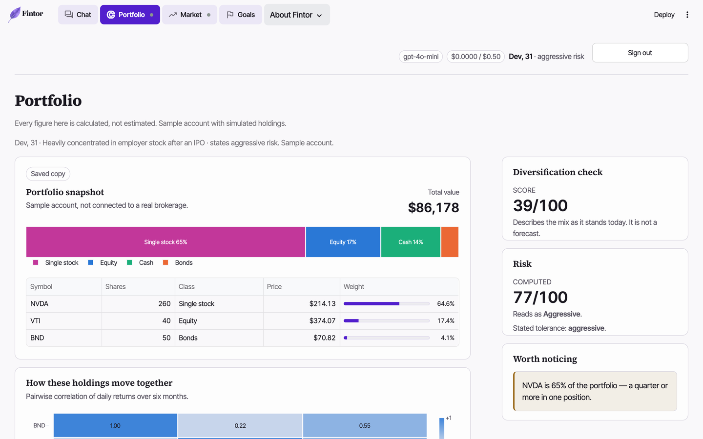
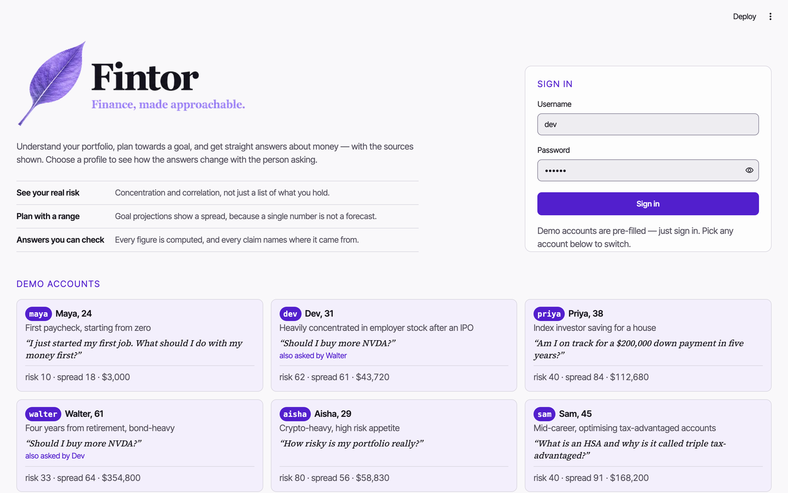

# Fintor

**AI-powered personal finance analysis.** Six specialist agents analyse a portfolio,
project a goal, read the market, and answer money questions in plain English — grounded
in a cited knowledge base and conditioned on whose finances are being discussed.

Every figure is computed in Python; the model explains results it cannot alter. Fintor
provides information and analysis. It does not give personal financial, investment,
legal or tax advice, and every answer says so.

---

---

## For reviewers

**Run it in one command. No API key needed.**

```bash
python3 -m venv .venv && .venv/bin/pip install -r requirements.txt
FINTOR_OFFLINE=1 .venv/bin/streamlit run src/web_app/app.py
```

Offline mode uses canned responses — no network, no spend, and every page works.
For live answers put `OPENAI_API_KEY` in `.env` and drop `FINTOR_OFFLINE=1`.

**Signing in takes one click.** The form arrives pre-filled; press *Sign in*. To see a
different portfolio, click any of the six account cards and press it again. (If you
would rather type: any of `maya`, `dev`, `priya`, `walter`, `aisha`, `sam`, password
`fintor`.)

| | |
|---|---|
| **Demo video** | [`docs/demo.mp4`](docs/demo.mp4) — 9 min 22 s, narrated and scored. Also inside the app under *About Fintor → Recording*. |
| **Tests** | 375, all passing offline with zero API spend: `FINTOR_OFFLINE=1 .venv/bin/python -m pytest -q` |
| **Coverage** | **83%** line coverage: `FINTOR_OFFLINE=1 .venv/bin/python -m pytest -q --cov=src` |
| **Design document** | [`docs/design.md`](docs/design.md), also rendered in-app under *About Fintor* |
| **Requirement traceability** | [`specs/traceability.md`](specs/traceability.md) — each requirement mapped to the code and the test that satisfies it |

### Where each capability lives

| Capability | Where to look |
|---|---|
| Six specialist agents | [`src/agents/`](src/agents/) — `registry.py` wires them; one file each |
| Workflow orchestration | [`src/workflow/graph.py`](src/workflow/graph.py) — LangGraph, `Send()` fan-out, `operator.add` reducers, SQLite checkpointer |
| Intent routing | [`src/workflow/router.py`](src/workflow/router.py) — three tiers; most questions never reach the model |
| RAG | [`src/rag/retriever.py`](src/rag/retriever.py) — dense + BM25 fused by reciprocal rank, difficulty and category filtering |
| Knowledge base | [`src/data/kb/fintor_kb.json`](src/data/kb/fintor_kb.json) — 77 cited entries, index committed so there is nothing to build |
| Live market data | [`src/data/market.py`](src/data/market.py) — yfinance, keyless, four-stage degradation |
| Financial computation | [`src/core/quant.py`](src/core/quant.py), [`src/core/market_calc.py`](src/core/market_calc.py) — all arithmetic, deterministic and unit-tested |
| Streamlit app | [`src/web_app/`](src/web_app/) — `app.py` is the entry point; pages under `views/` |
| Visualisation | [`src/web_app/charts.py`](src/web_app/charts.py) — palettes validated for contrast and colour-blind separation |
| MCP server | [`src/mcp_server/server.py`](src/mcp_server/server.py) — six tools over stdio; setup below |
| Transparency | *About Fintor → AI Internals* in the running app — routing tier, retrieval ranks, token ledger, guardrail counters for the last question |

### Running it as a container

```bash
docker build -t fintor .
docker run -e PORT=8080 -p 8080:8080 -e OPENAI_API_KEY=sk-... fintor
```

1.11 GB image, no network needed at startup — the embedding model and the retrieval
index are both baked in. Cloud Run deployment, the flags it needs and what the
deployment deliberately does not do are in [`docs/deploy.md`](docs/deploy.md).

### Submitting this as a ZIP

Use GitHub's **Code → Download ZIP**, which honours `.gitignore` and produces about
29 MB — most of it the demo video. Zipping a working copy locally would sweep in
`.venv` (~1 GB) and `build/` (~240 MB). The demo video is committed, so it travels
with either.

---

## The problem

People have no shortage of financial data. What they lack is a way to see what it means
for *them*.

A brokerage app shows a balance but not that 65% of it sits in one stock. A spreadsheet
projects a goal but hides the assumption doing the work. And a general-purpose chatbot
will cheerfully produce a confident number it never calculated — which is worse than no
answer, because it looks the same as a right one.

Fintor separates the two things those tools conflate:

| | |
|---|---|
| **Arithmetic** | Computed in Python, deterministic, unit-tested. The model cannot change a figure. |
| **Explanation** | Generated, cited to a retrieved passage, and conditioned on the person asking. |

A narration containing a number absent from the computed facts is **discarded whole** and
replaced by a deterministic template. That single rule is what makes the rest trustworthy.



## What it does

| Capability | What that means |
|---|---|
| **Portfolio analysis** | Value, allocation, diversification score, risk score against stated tolerance, concentration flags, and a correlation matrix — because diversification comes from owning things that *do not move together*, which weights alone never show. |
| **Goal planning** | Target projections with a spread either side of the assumed return. A single projection presented as a forecast is the most common way tools like this mislead people. |
| **Market context** | Prices, moving averages, max drawdown, annualised volatility, and benchmark comparison indexed to a common base — never a second y-axis. |
| **Grounded answers** | Hybrid retrieval over a cited corpus. A citation that does not resolve to a retrieved passage is stripped, and the count is reported. |
| **Personalisation** | The same question answered differently for a 31-year-old concentrated in one stock and a 61-year-old four years from retirement. |
| **Reusable services** | The same analysis functions exposed over **MCP** for external agent clients. |

### The demonstration that matters

Ask *"Should I buy more NVDA?"* as **Dev** (31, most of his portfolio in one employer stock) and then as
**Walter** (61, bond-heavy, four years from retiring).

Same agents. Same corpus. Same retrieval. The answers differ because the person asking does —
the profile sets a difficulty ceiling that filters the corpus before ranking, supplies a
different portfolio to reason about, and carries its own conversation thread.

Neither answer recommends buying anything.



## How it works

```
web_app  →  workflow  →  agents  →  { rag, data }  →  core
```

Strictly one-way, enforced by a build-time test. Every external dependency sits behind a
`typing.Protocol` in `src/core/ports.py` with at least two implementations, which is what
makes the seams real and the tests fast.

Five decisions worth the reading time:

- **A three-tier router.** Regex first, then embedding k-NN against intent centroids,
  and only then an LLM classifier. Most questions never reach tier three, so routing is
  usually free.
- **Dynamic fan-out, not a fixed pipeline.** `Send()` dispatches one payload per planned
  agent and they run concurrently; `operator.add` reducers merge the results. Without
  that reducer, concurrent writes to shared state silently drop.
- **Grounding is enforced, not requested.** Every `[n]` is verified against what was
  actually retrieved; unresolvable markers are stripped and counted.
- **Cost is a first-class constraint.** Seven cache layers, a session budget kill switch,
  and an offline mode that is never billed. The full suite runs with zero API spend.
- **The internals are on screen.** *About Fintor → AI Internals* reports the routing
  tier, retrieval ranks with fusion scores, every model call with tokens and cost, and
  the guardrail counters — for the run you just did.

```
Workspace                    About Fintor
├── Chat                     ├── Architecture      (7 diagrams, #1 generated from the graph)
├── Portfolio                ├── AI Internals      ← the machinery, made visible
├── Market                   ├── Design Document
└── Goals                    ├── Governance        (5 SKILL.md + traceability)
                             └── Recording
```

## Quick start

```bash
python3 -m venv .venv && .venv/bin/pip install -r requirements.txt

# Runs with no API keys at all: canned responses, zero network, zero spend.
FINTOR_OFFLINE=1 .venv/bin/streamlit run src/web_app/app.py

# Live: add OPENAI_API_KEY to .env (cp .env.example .env), then
.venv/bin/streamlit run src/web_app/app.py
```

### Signing in

**The demo form arrives pre-filled — just press Sign in.** Nothing to look up and
nothing to type.

**To use a different account, click its card.** The six accounts are shown under the
form; picking one fills the username and password for you. No password is displayed.

If you would rather type it: the usernames are `maya`, `dev`, `priya`, `walter`,
`aisha`, `sam`, and the password is **`fintor`**.

The username is the interesting half: it selects whose finances you are looking at,
and the same question gets a materially different answer as `dev` (31, concentrated
in one stock) than as `walter` (61, four years from retirement). That contrast is the
product.

The credential ships in `config.yaml` rather than `.env` so a fresh clone works with
no setup; the accounts are sample profiles holding simulated positions. It is stated
here rather than on the sign-in screen — a password printed on a login page reads as
careless even when nothing is behind it.

For a shared deployment set `FINTOR_DEMO_PASSWORD` in `.env`. It overrides the
default, and the fields then arrive empty. Blank in both places disables sign-in
entirely rather than letting anyone through.

The retrieval index is **committed**, so there is nothing to build before first run. Market
and news data need **no API keys** — yfinance and RSS are both keyless.

```bash
.venv/bin/python -m pytest -q          # 361 tests, no network, no spend
.venv/bin/python -m src.rag.build      # rebuild the index (only after corpus changes)
```

## What is in here

| Capability | Where |
|---|---|
| **Multi-agent fan-out** — `Send()` + `operator.add` reducer, agents run concurrently | `src/workflow/graph.py` |
| **Tool calling / ReAct** — `@tool` + `bind_tools` + `ToolNode` with a capped loop-back | `src/workflow/tools.py` |
| **Durable threads** — `AsyncSqliteSaver`, one thread per persona | `src/workflow/graph.py` |
| **Three-tier router** — regex → embedding k-NN vs intent centroids → LLM structured output | `src/workflow/router.py` |
| **Hybrid retrieval** — dense + BM25 fused by Reciprocal Rank Fusion (k=60) | `src/rag/retriever.py` |
| **Provider fallback** — OpenAI → Anthropic → offline, with per-call cost metering | `src/core/llm.py` |
| **Seven cache layers** + session budget kill switch | `src/core/cache.py`, `src/core/cost.py` |
| **Numeric grounding guard** — invented figures discard the whole narration | `src/agents/narration.py` |
| **Citation verification** — every `[n]` must resolve to a retrieved passage | `src/workflow/verify.py` |
| **Persona personalization** — prompt conditioning, difficulty-filtered retrieval, isolated threads | `src/data/personas.py` |
| **Six agents** | `src/agents/` |

Full rationale and all eight architecture diagrams: **[docs/design.md](docs/design.md)**.
The implementation plan: **[docs/PLAN.md](docs/PLAN.md)**.

## Personas

Switching persona changes the answer, not just the portfolio. Ask *"Should I buy more NVDA?"*
as **Dev** (70% in employer stock) and then as **Walter** (four years from retirement) — same
agents, same corpus, materially different answers.

| Persona | Profile | Computed risk / diversification |
|---|---|---|
| **Maya**, 24 | Beginner · $3k cash, no holdings | 10 / 18 |
| **Dev**, 31 | Intermediate · 70% employer stock | 78 / 35 |
| **Priya**, 38 | Intermediate · VTI/VXUS/BND, house in 5y | 52 / 80 |
| **Walter**, 61 | Advanced · bond-heavy, near retirement | 38 / 73 |
| **Aisha**, 29 | Intermediate · 40% crypto | 90 / 52 |
| **Sam**, 45 | Advanced · tax-focused | 53 / 86 |

All personas are synthetic teaching examples, never real accounts.

## Cost discipline

OpenAI credits were a binding constraint on this build, so cost is a design feature rather
than an afterthought.

- **`FINTOR_OFFLINE=1`** runs the full workflow — routing, retrieval, fan-out, metering — with
  the language model replaced by deterministic canned responses. Zero network, zero spend.
- **Local embeddings by default** (model2vec, 256-d, no torch). `rag.embeddings: openai`
  switches to hosted; the index refuses to load against a mismatched embedder.
- **Seven cache layers**, from exact LLM responses on disk to Streamlit resource singletons.
  Cache hits are still metered with `usd = 0` — a saving nobody can measure is a saving nobody
  believes.
- **A hard session budget** (`cost.session_budget_usd`) that raises before spending, not after.
- **Tests never pay.** A session fixture blocks `socket`, so an accidental call fails loudly.

The **AI Internals** page shows all of it live: routing tier, retrieval ranks, cache tier,
tokens, USD, budget remaining, per-persona spend.

## Spec-driven development

Every feature has a numbered spec in [`specs/`](specs/) with executable acceptance criteria,
committed **before** its implementation. `git log` shows the ordering; the mapping from
criterion to test lives in [`specs/traceability.md`](specs/traceability.md).

Two structural bugs were caught by those tests rather than by review:

1. `test_no_upward_imports` found the composition root sitting in `core` — the bottom layer —
   while importing from every layer above it.
2. A workflow criterion found that the graph's agent node contained only `TimeoutError`, so an
   agent failing outside `BaseAgent`'s contract took down every fanned-out branch.

## AI governance

Guardrails live as repository artifacts in GitHub Copilot customization format, and were
committed **first** — they constrain the code written after them. Rendered in-app on the
**Governance** page.

| Skill | Encodes |
|---|---|
| [`finance-compliance`](.github/skills/finance-compliance/SKILL.md) | The education/advice boundary, disclaimers, refusal-and-redirect phrasing |
| [`ai-grounding`](.github/skills/ai-grounding/SKILL.md) | Figures trace to computed facts; citations verified; refuse below threshold |
| [`llm-cost-discipline`](.github/skills/llm-cost-discipline/SKILL.md) | Cache before calling; never pay in a test; local embeddings default |
| [`prompt-safety`](.github/skills/prompt-safety/SKILL.md) | User and third-party text are data, never instructions; PII fail-closed |
| [`spec-driven-development`](.github/skills/spec-driven-development/SKILL.md) | No code without a spec, criteria, and a test |

Plus [`.github/copilot-instructions.md`](.github/copilot-instructions.md) for repo-wide
conventions, including the one-way dependency rule.

## Repository layout

```
fintor/
├── .github/{copilot-instructions.md, skills/}   AI governance
├── specs/                                        numbered specs + traceability
├── docs/{design.md, PLAN.md}
├── src/
│   ├── container.py      composition root (imports everything; only entry points import it)
│   ├── core/             ports · contracts · llm · cache · cost · quant · safety · config
│   ├── rag/              embeddings · index · retriever · categories · build
│   ├── data/             market · news · personas · kb/ (corpus + committed index)
│   ├── agents/           6 specialists · base · narration · registry
│   ├── workflow/         graph · router · tools · verify
│   └── web_app/          app.py · gate · chrome · views/ · theme · brand · assets/
└── tests/                361 tests
```

## Usage examples

**Run with no keys and no network.** Canned answers, zero spend — this is the fastest
way to see the whole app.

```bash
FINTOR_OFFLINE=1 streamlit run src/web_app/app.py
```

**Run live.** Copy `.env.example` to `.env` and set at minimum:

```bash
OPENAI_API_KEY=sk-...            # the only key needed for live answers
FINTOR_DEMO_PASSWORD=<yours>     # required, or sign-in refuses everyone
streamlit run src/web_app/app.py
```

**Sign in.** The six personas *are* the accounts: usernames `maya`, `dev`, `priya`,
`walter`, `aisha`, `sam`, all sharing `FINTOR_DEMO_PASSWORD`. The username selects who
you are, so authenticating and choosing a reader are one step.

**See personalization working.** Ask the same question as two different readers:

```
sign in as dev     → "Should I buy more NVDA?"   (31, 70% in one stock)
sign out, as walter→ "Should I buy more NVDA?"   (61, four years from retiring)
```

Same agents, same corpus, same question. The answers differ because the persona sets the
difficulty ceiling, the risk framing, the portfolio in scope and its own conversation thread.

**Trigger a multi-agent fan-out:**

```
"How are capital gains taxed and how is SPY doing?"
```

Two agents run concurrently; their sections merge and the citations renumber across the
whole answer. Watch it happen on **AI Internals**.

**Rebuild the retrieval index** after editing the corpus:

```bash
python -m src.rag.build --reset
```

## API documentation

**Agents.** Every specialist subclasses `BaseAgent` (`src/agents/base.py`) and implements
one method. `run()` wraps it with timeout, tracing and error capture, so a failing agent
degrades the answer instead of the request.

```python
class BaseAgent(ABC):
    async def _execute(self, query: Query, persona: Persona | None) -> AgentResult: ...
    async def run(self, query: Query, persona: Persona | None = None) -> AgentResult
```

**Tools** (`src/workflow/tools.py`) are LangChain `@tool` functions closed over the
container, so they share its cache and cost meter. They are driven by a real ReAct loop
with an iteration cap.

| Tool | Signature | Returns |
|---|---|---|
| `get_quote` | `(symbols: str)` — comma-separated tickers | latest price and daily change |
| `get_price_history` | `(symbol: str, period: str = "6mo")` — `1mo`/`3mo`/`6mo`/`1y` | change, low and high over the period |

`build_tool_graph(deps, max_iterations=3)` assembles the loop.

**Workflow.** `src/workflow/graph.py` exposes two entry points. Both are async.

```python
await run_query(deps, question, persona=..., thread_id=..., checkpoint_path=...)
async for node, payload in stream_query(deps, question, ...):   # used by the UI
```

`stream_query` yields `(node_name, payload)` as each node completes, then one terminal
`TRACE_EVENT` carrying the Langfuse trace id.

**Ports.** Every external dependency sits behind a `typing.Protocol` in
`src/core/ports.py` — `ChatProvider`, `CacheBackend`, `MarketProvider`, `Embedder` — each
with at least two implementations, which is what makes the seams real and the tests fast.

**Environment contract** (read only by `src/core/config.py`):

| Variable | Required | Effect |
|---|---|---|
| `OPENAI_API_KEY` | for live answers | primary chat provider |
| `FINTOR_DEMO_PASSWORD` | **yes** | sign-in; blank means sign-in refuses everyone |
| `FINTOR_OFFLINE` | no | `1` = canned answers, no network, no spend |
| `FINTOR_SESSION_BUDGET_USD` | no | overrides the session kill switch |
| `LANGFUSE_PUBLIC_KEY` / `LANGFUSE_SECRET_KEY` / `LANGFUSE_BASE_URL` | no | tracing; absent means tracing is simply off |
| `ANTHROPIC_API_KEY` | no | fallback provider; unset, so the chain never reaches it |

## MCP server (Claude Desktop)

Fintor's finance tools are also exposed over the **Model Context Protocol**, so
Claude Desktop can compute with them directly.

```bash
.venv/bin/python -m src.mcp_server        # stdio
```

Add to `~/Library/Application Support/Claude/claude_desktop_config.json`
(macOS) or `%APPDATA%\Claude\claude_desktop_config.json` (Windows), using
**absolute** paths:

```json
{
  "mcpServers": {
    "fintor": {
      "command": "/absolute/path/to/fintor/.venv/bin/python",
      "args": ["-m", "src.mcp_server"],
      "cwd": "/absolute/path/to/fintor"
    }
  }
}
```

Restart Claude Desktop; the tools appear under the connector menu.

| Tool | Returns |
|---|---|
| `analyze_portfolio` | Total, weights, class mix, diversification, risk score, concentration flags |
| `project_goal` | A savings projection with a spread either side of the assumed return |
| `analyze_price_series` | Period return, max drawdown, annualised volatility |
| `correlate` | Correlation matrix across several price series |
| `list_demo_personas` | The six synthetic readers, shaped as input for the tools above |
| `search_knowledge_base` | Cited passages from the glossary, with source names and URLs |

**No API key, no network, no model.** Every tool delegates to the same
functions the app uses (`src/core/quant.py`, `src/core/market_calc.py`) and
computes locally — the client is already a model, so the server does not need
one. It cannot run up a bill sitting in your config file.

Implementation notes are in [`docs/design.md`](docs/design.md#7-mcp-server).

## On the vector store

The brief suggests FAISS, Chroma or Pinecone. Fintor uses a `NumpyIndex`
(`src/rag/index.py`) doing an exact cosine scan, for two reasons. Python 3.14 has no FAISS
wheel — nor one for `onnxruntime`, which is why embeddings are `model2vec` static vectors
rather than a transformer encoder. And over a 77-document corpus an exact scan returns
*the same neighbours* an approximate index would, without the index-build step or the
recall/latency trade. The retrieval interface is a port, so swapping in FAISS at corpus
scale is a container change, not a rewrite.

## Troubleshooting

| Symptom | Cause and fix |
|---|---|
| `IndexMismatch: index was built with … ` | The embedding model changed. `python -m src.rag.build --reset`. |
| `BudgetExceeded` | Session budget spent. Raise `cost.session_budget_usd`, or use `FINTOR_OFFLINE=1`. |
| Market data shows `SAMPLE DATA` | Yahoo throttled or changed shape. The chain fell through to the labelled mock; wait, or rely on the TTL cache. |
| Answers say `[offline mode]` | `FINTOR_OFFLINE=1` is set, or no `OPENAI_API_KEY` is configured. |
| Mermaid diagrams render as code blocks | `streamlit-mermaid` failed to load; the raw diagram source is shown as a fallback. |

## Known limits

Static embeddings are weaker than a transformer encoder. The corpus is 77 documents. yfinance
is an unofficial wrapper. Safety is regex plus prompt posture, not a classifier. No PII
redaction yet — which is why personas carry no real data. Phase 2–4 work is listed at the end
of [docs/design.md](docs/design.md).

---

*Educational only. Not financial, investment, legal or tax advice.*
