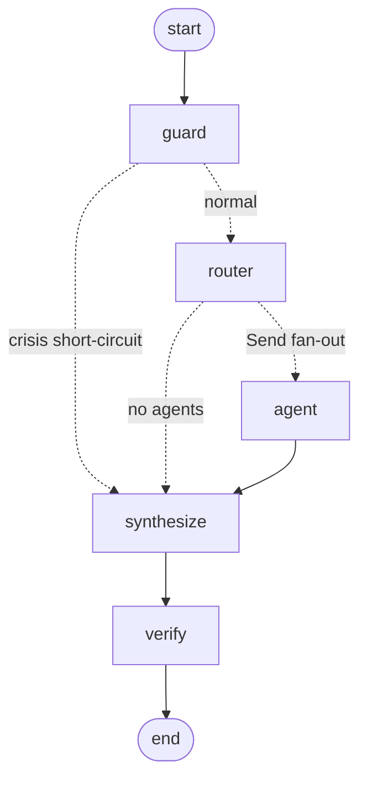
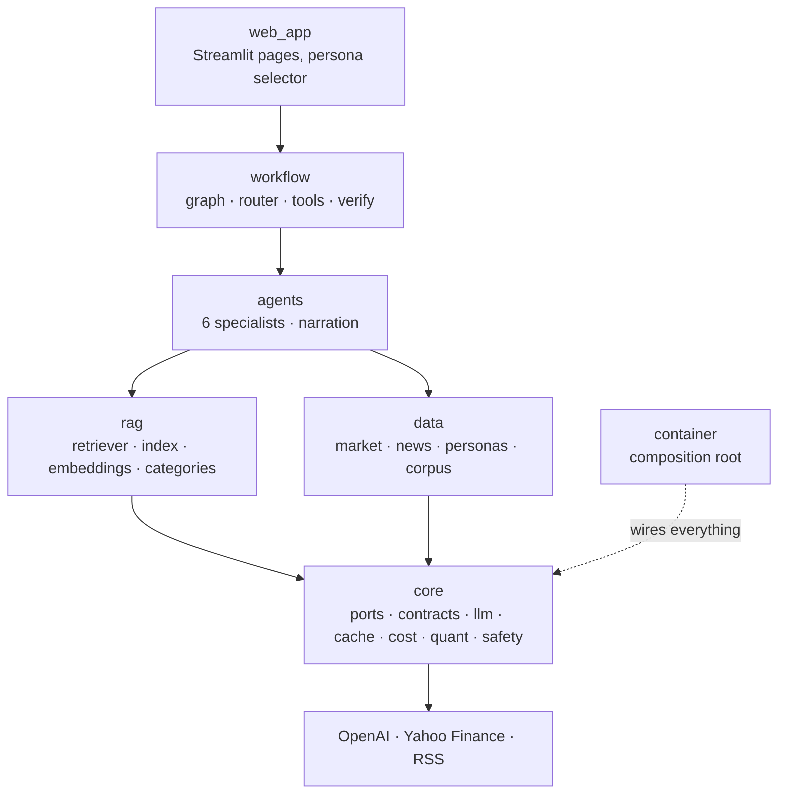
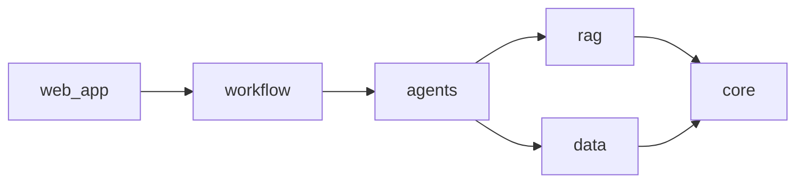
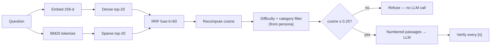
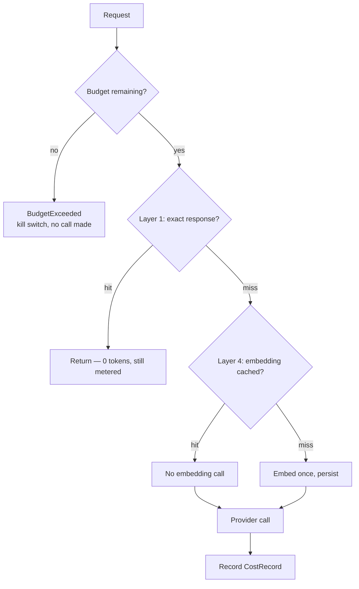
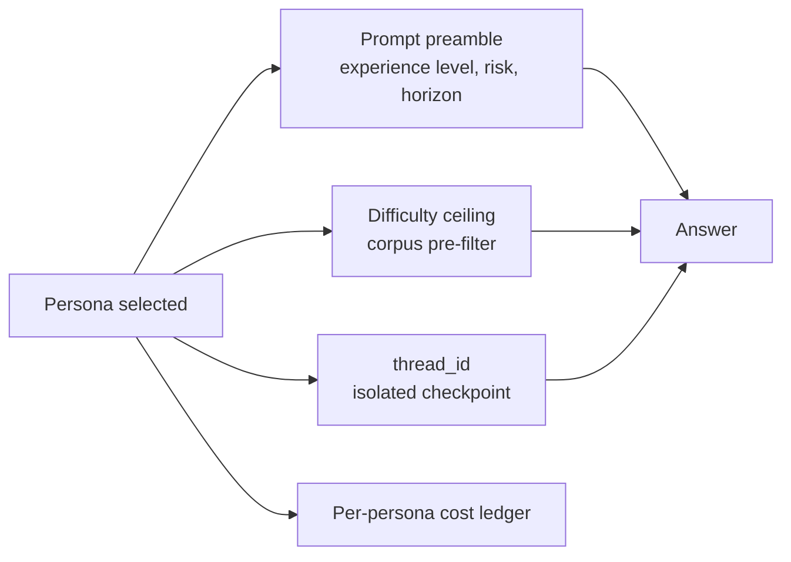

# Fintor — design document

Multi-agent AI **finance assistant**. Six specialist agents answer money questions in plain
English, grounded in a cited knowledge base, enriched with keyless live market data, and
conditioned on a selectable synthetic profile. It informs and analyses; it does not advise.

---

## 1. Goals and principles

| Principle | Consequence in the code |
|---|---|
| **Code computes, the model explains** | Every figure originates in `src/core/quant.py` or a provider payload. Narration is checked against those facts and discarded whole if it introduces a number. |
| **Education, not advice** | No buy/sell output, no price predictions, no personal tax computation. One disclaimer, appended idempotently. |
| **Refuse rather than guess** | A relevance floor runs *before* the LLM. Nothing clears it → no model call at all. |
| **Make the machinery visible** | Routing tier, retrieval ranks, cache tier, token cost, and guardrail results are all rendered in the AI Internals page. |
| **Cost is a design constraint** | Seven cache layers, a cheap-by-default model tier, a hard session budget, and an offline mode that runs the whole app for free. |
| **Modularity enforced, not requested** | A one-way dependency rule with a build-time fitness test; every external dependency behind a Protocol. |

---

## 2. Architecture

### 2.1 Workflow graph

Generated from the compiled graph via `compiled.get_graph().draw_mermaid()`, so it cannot
drift from the code. The in-app **Architecture** page renders the live version.

`agent` is **one reusable node**. Fan-out is dynamic via `Send()`, one payload per planned
agent, and `agent_results` carries an `operator.add` reducer. Without that reducer, concurrent
branches would overwrite each other and only the last one home would survive — which is the
single most important thing to understand about parallel state in LangGraph.

### 2.2 System layers

### 2.3 Dependency rule

Strictly one-way. `tests/test_architecture.py::test_no_upward_imports` walks every module's
AST and fails the build on a violation. It caught a real inversion on day one: the composition
root was sitting in `core`, the bottom layer, while importing from every layer above it. Fixed
by moving it to `src/container.py`, with a second test asserting that only entry points import
it.

### 2.4 Retrieval pipeline

**Why RRF rather than a weighted score blend.** Cosine similarity and BM25 relevance live on
different, un-normalizable scales. Any weighted sum needs arbitrary constants that silently
shift as the corpus changes. RRF uses only *rank*, which is comparable by construction. The
true cosine is then recomputed on the fused set, because an RRF score says nothing about
whether the top hit is actually relevant — it only says it was ranked highly by something.

### 2.5 Caching and cost control

### 2.6 Persona conditioning

---

## 3. Component design

### 3.1 Three-tier router

| Tier | Mechanism | Cost | When it runs |
|---|---|---|---|
| 1 | Regex signal banks per intent, clause-split, multi-label | free | always |
| 2 | Query embedding vs. per-intent centroids built from exemplar phrases | free | tier 1 not confident |
| 3 | LLM classifier with Pydantic structured output | paid | tiers 1–2 inconclusive |

Two rules worth noting. A **comparison is not split into clauses**, so "difference between an
ETF and a mutual fund" stays one question instead of becoming two half-answers. And a ticker
inside a tax question is suppressed as a price lookup **only when both signals fired in the
same clause** — so "how are capital gains taxed and how is SPY doing?" correctly fans out to
two agents, while "what tax do I pay on my NVDA shares?" does not.

Tier 2 requires both a similarity floor and a **margin over the runner-up**: a query sitting
equally close to two centroids is ambiguous no matter how high the top score is.

Routing never raises. A tier-3 failure returns the tier-1 result tagged
`llm_fallback_rules` — failing to route is not a reason to fail to answer.

### 3.2 The six agents

| Agent | Distinct mechanism |
|---|---|
| `finance_qa` | The RAG agent. Gate → numbered passages → cited answer. Its prompt now says to **stop** rather than continue uncited, after a live run showed it filling a gap from model recall. |
| `tax` | Subclass of `finance_qa`: stricter prompt, corpus scoped to the **tax group** (not one raw category — "What is an HSA?" is a tax question whose passage lives under `retirement`), plus a personal-tax redirect applied after the answer so it appears exactly once. |
| `portfolio` | Zero LLM arithmetic. `quant.py` computes value, weights, HHI-based effective positions, diversification and risk scores, concentration flags; the model only narrates. |
| `market` | Deterministic entity extraction instead of tool-arg guessing; index names map to ETF proxies and the substitution is disclosed. |
| `goal_planning` | The only agent with an LLM extractor, behind a hard verifier: any numeric field whose value does not appear literally in the user's message is dropped. Every field is optional so "nothing extracted" is a valid outcome. |
| `news` | Headlines treated as untrusted third-party text. Sample headlines are **never narrated** — a model paraphrasing placeholder news reads as real reporting. |

### 3.3 Grounding

`agents/narration.py` hands the model a FACTS payload and then checks the prose it returns.
Every significant figure (`$`, `%`, `k/M/B`, or a bare number ≥1000 that is not a year) must
be within tolerance of a number in the payload. Tolerances cover display rounding — `$29,300`
for `29300.0`, or `$29,000` as a thousands rounding — but not invention. One ungrounded figure
discards the **whole** narration and substitutes the deterministic template, recorded as
`narration="template"` so the swap is visible rather than silent.

This is a programmatic check, not a critic model. It is exact, free, and cannot itself
hallucinate.

### 3.4 Citation verification

The prompts require inline `[n]` markers, but a model can emit `[4]` when three passages were
supplied, and nothing downstream would notice. `workflow/verify.py` asserts every marker
resolves to a citation actually retrieved for that answer, strips the rest, and reports the
count. Across a fan-out, citations are **renumbered per agent** so two agents' `[1]` never
collide.

### 3.5 Provider chain

`build_chain` composes OpenAI then Anthropic, skipping any provider without a key and falling
back to `OfflineProvider` when none exists — so the app runs before it is configured. Each
call: budget guard → exact cache → providers in order. A provider failure is not a caller
error; the next one answers and `fallback_used` is recorded for the Internals page.

---

## 4. Key decisions and trade-offs

| Decision | Why | Cost |
|---|---|---|
| **model2vec instead of sentence-transformers** | No cp314 torch wheel exists on this platform (Intel macOS, Python 3.14). model2vec is numpy-only, free, offline-capable. | Static embeddings carry less contextual nuance than a transformer encoder. The BM25 half of hybrid retrieval is doing real work here, not decoration. |
| **NumpyIndex instead of FAISS** | At ~300 chunks an exact dot product is microseconds, and FAISS `IndexFlatIP` performs the identical brute-force scan. No cp314 wheel either. | Would need replacing at 10⁵+ chunks. `VectorIndex` is a Protocol, so that is a config change. |
| **Hand-rolled exact cache, not `set_llm_cache`** | LangChain's cache is transparent to the caller, so a hit is indistinguishable from a miss — and the Internals page must report *which* layer served the response. | A little more code for the same storage. |
| **Hand-authored corpus, not LLM-generated** | Free, deterministic, and every `source_url` is real. | Author time, and 77 documents rather than hundreds. |
| **yfinance, not Alpha Vantage** | Keyless. Alpha Vantage's free tier is 25 requests/day, which forces a quota tracker to work around. | Unofficial wrapper: it breaks on upstream changes (1.7 broke `fast_info`, so quotes derive from `Ticker.history()`) and throttles by IP. Mitigated by the TTL cache and a labelled mock at the end of the chain. |
| **Tool loop as a subgraph** | The main graph's `Send` fan-out targets a single node; a loop-back edge there would re-enter every fanned-out branch. | One more compiled graph to reason about. |
| **AsyncSqliteSaver, connection per call** | The graph is async; `SqliteSaver` raises on `aget_tuple`. State lives on disk, so a fresh connection still sees prior checkpoints. | Slight per-call overhead, avoided holding an event-loop-bound connection across Streamlit reruns. |

---

## 5. Testing strategy

378 tests, 83% line coverage. No network, no API spend — a session fixture replaces
`socket.socket` so an accidental connection fails loudly instead of billing.

| Layer | What is asserted |
|---|---|
| Architecture | The dependency rule, `core` purity, ≥2 implementations per Protocol, composition-root direction |
| Retrieval | RRF arithmetic, dimension-mismatch guard, the refusal gate, difficulty filtering, sparse independence, corpus integrity, embedding-cache persistence |
| Routing | 8 parametrized tier-1 cases, compound questions, comparison handling, all three tiers, fallback on tier-3 failure |
| Workflow | Reducer merge, concurrency timing, citation renumbering, crisis short-circuit, tool-loop termination and its cap, error containment |
| Cost | Zero-call cache hits, offline determinism, the budget kill switch, provider fallback, metered hits |
| Views | Every page renders for every persona without raising — the blank-screen alarm nothing else catches |
| Agents | Per agent: the relevance gate makes zero LLM calls, sample news is never narrated, a personal tax question is redirected, a hallucinated figure is dropped from an extraction, a failing agent costs one section |
| MCP | Every tool's output equals the `quant`/`market_calc` function it wraps, dispatched through `call_tool` rather than around it |

**Where the coverage is, and where it is not.** 83% overall, clearing the brief's 80%.
The six agents are now 84-100% each, having been 16-52%: nothing imported `src.agents`
for behaviour at all, so ~320 statements of the product's core were guarded only by the
workflow tests mocking them away. `src/rag/build.py` and `src/core/ports.py` left 0%.

What remains uncovered is mostly adapter code with external edges - `data/news.py` (30%),
`core/llm.py` (57%), `data/market.py` (54%) - plus `views/chat.py` (40%), whose
uncovered half is the streaming-response path.

That took two attempts, and the first one is worth recording because it looked like it
worked. It drove the real `app.py` and set `query_params["page"]` to navigate.
`st.navigation` ignores `query_params`, so all 21 tests rendered the same default Chat
page — coverage did not move, and `views/about.py` actually *dropped* to 19%. A suite
that green-lights 21 assertions while exercising one page is worse than no suite, because
it reports safety it does not provide. Invoking each view function directly through
`AppTest.from_string` took `views/workspace.py` from 12% to 98% and the project from 62%
to 73%; the agent suite below took it from 73% to 82%.

`views/chat.py` remains at 40%: the uncovered half is the streaming-response path, which
needs a live model call and is covered instead by the workflow tests underneath it.

Every acceptance criterion maps to a named test in [`specs/traceability.md`](../specs/traceability.md).
Two structural bugs were found by the tests rather than by review — both recorded there.

---

## 6. Performance

Cost and latency were design inputs, not an afterthought — the whole point of a
three-tier router is to avoid paying for classification.

**Router.** Tier 1 is regex: no model call, sub-millisecond. Tier 2 compares the question
against intent centroids with a static embedding — no model call either, and the
embedding is cached. Only tier 3 bills a classification, and the rule parametrization in
`tests/test_router.py` keeps the common questions in tier 1. The trace on the AI Internals
page reports which tier resolved each question, so the mix is observable rather than
asserted.

**Caching.** Four distinct layers, each verifiable on that same page: an exact-match
completion cache keyed on the full request, an embedding cache persisted to disk, a market
-data cache with a TTL, and an offline mode that never bills at all. A repeated question is
served at zero tokens and zero cost — `tests/test_cost.py` asserts the call count is zero
rather than merely that the answer matched.

**Retrieval.** `NumpyIndex` does exact cosine over 77 chunks. At that size an approximate
index would add a dependency and an index-build step to save microseconds on a dot product
that is already dominated by Streamlit's rerun. BM25 runs over the same corpus in process.
Both are in-memory after first load; the cost is the model2vec encode, which is cached.

**What is not optimised.** Each Streamlit rerun re-renders the whole page — that is the
framework's model, and at this corpus size it is not the bottleneck. Agent fan-out is
concurrent, but the slowest agent sets the floor for a multi-intent question.

---

## 7. MCP server

`src/mcp_server/server.py` exposes six finance tools over the Model Context
Protocol (`mcp` 2.x, `MCPServer`, stdio transport). Setup and the tool table are
in the [README](../README.md#mcp-server-claude-desktop).

**It is an adapter, and deliberately nothing more.** Every tool delegates to
`src/core/quant.py` or `src/core/market_calc.py`. No finance logic lives behind
the protocol boundary, because logic that lives only there is logic nobody can
test without standing up a protocol client. `tests/test_mcp_server.py` asserts
delegation directly — a tool's output must equal what the underlying function
returns, so "simplifying" the adapter by inlining the maths fails the build.

**No model, no key, no network.** The client is the model; a second one would
be paying twice for a worse answer. The practical consequence is that this
server cannot incur cost while sitting in someone's config file, and the
session socket block in `tests/conftest.py` turns that into an assertion rather
than an intention.

**Tested through dispatch, not around it.** The tests call
`server.call_tool(name, args)` — the same path a client takes — rather than the
undecorated Python functions. Calling those directly would leave registration,
the generated input schema and the JSON round-trip untested, which is precisely
the layer an MCP server *is*.

Two things that only surfaced by testing through the protocol:

- `analyze_price_series` originally called `volatility` for any series of two
  or more points. `market_calc` requires ten and raises below that, so a short
  series propagated `InsufficientData` through the protocol and failed the
  whole call. It now returns the statistics the series can support and names
  the one it cannot.
- `correlation_matrix` sorts its labels and correlates *returns*, not prices.
  A rising and a falling ramp look mirrored but correlate at +0.81, because
  both have decaying returns.

`search_knowledge_base` is the one tool with a heavy dependency. The retriever
is built lazily and a failure is caught and returned as a message, so a missing
index degrades that tool instead of taking the other five with it.

---

## 8. Known limits and next steps

**Current limits.** Static embeddings are weaker than a transformer encoder. The corpus is 77
documents. yfinance is unofficial and throttles on shared egress IPs. Safety is regex plus
prompt posture, not a classifier — the code says so where it matters. There is no PII
redaction yet, so personas carry no real data by design.

**Phase 2** — cross-encoder reranking, HyDE and multi-query expansion, a reflection/critique
cycle, LLM-as-judge evals (faithfulness, answer relevancy, context precision) over a golden
set, semantic and prompt caching, the retrieval candidates table, `.github/instructions/*`
and `.github/agents/*`.

**Phase 3** — Monte Carlo goal projection with a P10/P50/P90 fan chart, portfolio theory
(Sharpe, Sortino, beta, correlation heatmap, VaR), risk-mismatch detection, news sentiment,
headline clustering, multimodal statement parsing, long-term per-persona memory, Presidio PII
redaction.

**Phase 4** — voice, Docker + Cloud Run, GitHub Actions CI with `ruff`. (The MCP server and sign-in have since shipped; see §7 and `src/core/auth.py`.)
